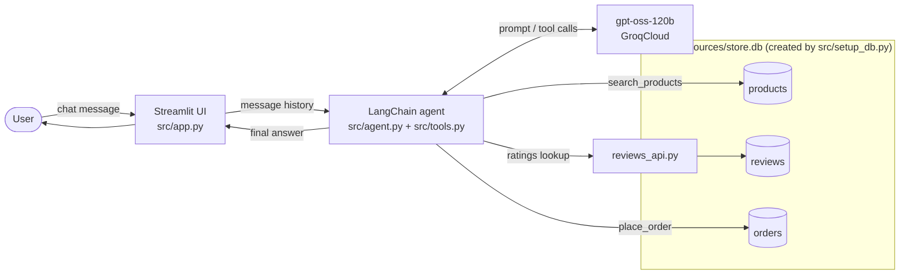
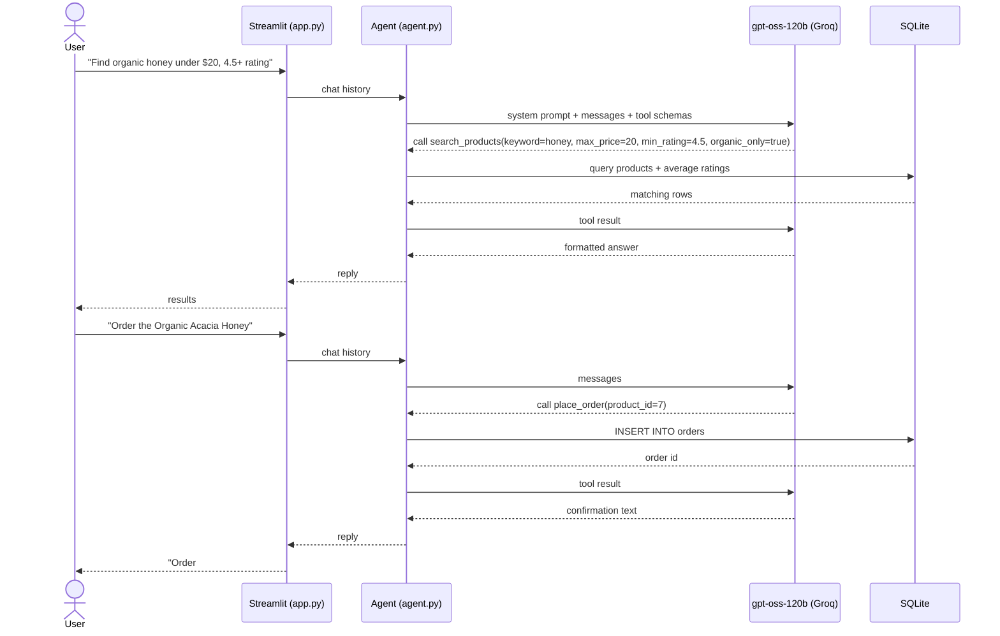

# Shopping Agent

A prototype AI shopping agent. Ask for products in plain English (for example, *"find me organic honey under $20 with 4.5+ rating"*) and then order a specific item. Orders are only recorded as a row in the `orders` table; there is no payment or fulfilment.

## Tech stack

| Concern | Choice |
|---|---|
| Agent framework | [LangChain](https://python.langchain.com/) (`create_agent`) |
| LLM | `openai/gpt-oss-120b` on [GroqCloud](https://console.groq.com/) (`langchain-groq`) |
| UI | [Streamlit](https://streamlit.io/) |
| Database | SQLite (`resources/store.db`) |
| Package manager | [uv](https://docs.astral.sh/uv/) |

## Architecture



### Request flow



## Project layout

```
shopping-agent/
├── pyproject.toml        # uv project and dependencies
├── .env.example          # copy to .env and set GROQ_API_KEY
├── resources/store.db    # SQLite database (generated, git-ignored)
└── src/
    ├── setup_db.py       # creates tables and seeds 32 products + reviews
    ├── reviews_api.py    # average rating / review count helpers
    ├── tools.py          # tools: search_products, place_order
    ├── agent.py          # LangChain agent (LLM + system prompt + tools)
    └── app.py            # Streamlit chat UI
```

### Database schema

- `products(id, name, category, price, description, is_organic)`
- `reviews(id, product_id, rating, reviewer_name, review_text)`
- `orders(id, product_id, product_name, price, ordered_at)`

### Agent tools

| Tool | Purpose |
|---|---|
| `search_products(keyword, category, max_price, min_price, organic_only, min_rating)` | Filters the catalog; ratings are averaged from `reviews` |
| `place_order(product_id)` | Looks up the product and inserts a row into `orders` |
| `list_orders()` | Returns every row in `orders` (newest first) with a total |

The system prompt tells the agent to order only when the user clearly asks to buy a specific item, and to ask which product when several match.

## Getting started

Prerequisites: [uv](https://docs.astral.sh/uv/getting-started/installation/) and a Groq API key.

```bash
# 1. Install dependencies
uv sync

# 2. Configure the API key
cp .env.example .env
# edit .env and set GROQ_API_KEY=<your key>

# 3. (Optional) create / reset the database; the app also does this on first start
uv run python src/setup_db.py

# 4. Run the app
uv run streamlit run src/app.py
```

Open http://localhost:8501.

> Re-running `setup_db.py` re-seeds products and reviews. It does not delete existing orders.

## Using the app

- The left panel has a **New chat** button at the top and sample questions below it. Click a sample to run it.
- Example prompts:
  - "Find me organic honey under $20 with 4.5+ rating"
  - "Show organic snacks under $10"
  - "Order the Organic Acacia Honey"
- To check recorded orders:

```bash
sqlite3 resources/store.db "select * from orders"
```

## Configuration

| Variable | Default | Description |
|---|---|---|
| `GROQ_API_KEY` | none (required) | GroqCloud API key, read from `.env` |
| `DB_PATH` | `resources/store.db` | Optional override for the SQLite file location |

## Limitations (prototype)

- No authentication, cart, payment, inventory or quantity handling; each order is a single item.
- Orders have no dedicated UI panel; ask the agent "show all my orders".
- Chat history lives in the Streamlit session only.

---

*Created using Anthropic Claude. Keep this on internal versions until a human has reviewed and verified the content.*
