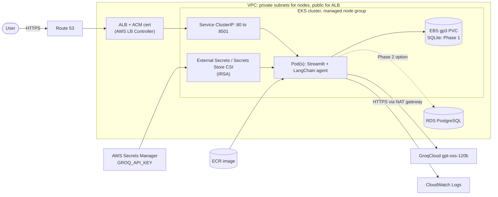

# Plan: deploy the Fresh Cart shopping agent to AWS EKS

> Created using Anthropic Claude. Keep this as an internal draft until a human has reviewed and verified the content.

Status: **plan only, nothing has been created in AWS.** Items in `<angle brackets>` are values we need from you.

## 1. Starting point and gaps

| Today (Docker Desktop) | Needed on EKS |
|---|---|
| Local image `shopping-agent-shopping-agent:latest` | Image in **ECR**, built for the node CPU architecture (`linux/amd64` unless using Graviton; your Mac builds `arm64` by default) |
| NodePort + `kubectl port-forward` | **ALB** via AWS Load Balancer Controller (Ingress), HTTPS with an ACM certificate |
| Secret created from `.env` | Key kept in **AWS Secrets Manager** (WBD: credentials go through GICS), synced to the pod |
| PVC on Docker Desktop storage, 2 replicas sharing SQLite | **EBS CSI** volume is single-AZ, single-writer. SQLite does not scale to 2 replicas (see section 3) |
| No liveness probe, no TLS, no autoscaling | Add liveness probe, TLS, resource tuning |

## 2. Target architecture



## 3. Key decision: the database

Your current manifest runs 2 replicas on one SQLite file. On EKS an EBS volume attaches to **one node in one AZ**, so 2 pods only work if both land on the same node, and concurrent writes still risk "database is locked". Options:

| Option | Effort | Notes |
|---|---|---|
| **A. 1 replica + EBS gp3 PVC** (recommended for the prototype) | Low | No code changes. Brief downtime on pod restart (Recreate). No HA. |
| B. 2+ replicas on EFS | Medium | Multi-AZ, but SQLite over NFS is unsafe for concurrent writes. Not recommended. |
| C. RDS PostgreSQL | Higher | Needs code changes in `setup_db.py`, `reviews_api.py`, `tools.py` (SQLite to Postgres). Right choice if you want HA or scale. |

**Plan: Phase 1 = option A, Phase 2 = option C if the prototype is kept.**

## 4. Steps

### Phase 0: prerequisites and decisions
- [ ] Confirm: AWS account, region, VPC (new or existing), cluster name, domain/hostname, who owns the cluster. `<account-id>`, `<region>`, `<hostname>`
- [ ] Confirm tooling: `aws`, `kubectl`, `eksctl` (or Terraform), `helm`, Docker with buildx.
- [ ] Policy: credentials via GICS; the app is a prototype, so confirm whether **Technology Intake review** applies before any consumer-facing use.
- [ ] Confirm outbound access to `api.groq.com` is allowed from the VPC (NAT gateway and any egress firewall rules). Chat prompts leave AWS to a third party, so confirm that is approved for the data involved.

### Phase 1: image to ECR
1. Create an ECR repository `shopping-agent` (scan on push enabled).
2. Build for the node architecture and push:
```bash
aws ecr get-login-password --region <region> | docker login --username AWS --password-stdin <account-id>.dkr.ecr.<region>.amazonaws.com
docker buildx build --platform linux/amd64 -t <account-id>.dkr.ecr.<region>.amazonaws.com/shopping-agent:<git-sha> --push .
```
3. Use an immutable tag (git SHA), not `:latest`.
4. Dockerfile tweak: the current `COPY . .` also copies `resources/`; `.dockerignore` already excludes `.env`, but confirm `resources/store.db` is excluded so a local DB is not baked in.

### Phase 2: cluster
1. Create the EKS cluster (Kubernetes 1.3x) with a managed node group: 2 x `t3.medium` across 2 AZs is enough for the prototype. Enable the OIDC provider (for IRSA).
2. Install add-ons: **EBS CSI driver**, **AWS Load Balancer Controller**, CoreDNS/kube-proxy/VPC CNI (default).
3. Create a `gp3` StorageClass (`WaitForFirstConsumer`).
4. Configure `kubectl` access: `aws eks update-kubeconfig --name <cluster> --region <region>`.

### Phase 3: secrets
1. Store `GROQ_API_KEY` in Secrets Manager (through your GICS process).
2. Install **External Secrets Operator** (or the Secrets Store CSI driver) with an IRSA role limited to that one secret (`secretsmanager:GetSecretValue`).
3. Create an `ExternalSecret` that produces the Kubernetes Secret `shopping-agent-env`, so the Deployment's `envFrom` stays unchanged.

### Phase 4: manifests (new `k8s/eks/` folder; existing `k8s/deployment.yaml` stays for local use)
Changes versus the current file:
- `image:` set to the ECR URI and tag.
- `replicas: 1`, `strategy: Recreate`.
- PVC `storageClassName: gp3`.
- Add a **liveness probe** (`/_stcore/health`, initial delay 20s) and keep the readiness probe.
- Service becomes `ClusterIP` (drop NodePort).
- Add an **Ingress** (`ingressClassName: alb`) with annotations: `scheme internet-facing` (or `internal`, see open questions), ACM certificate ARN, HTTP to HTTPS redirect, health check path `/_stcore/health`, and **target group stickiness** (replaces `sessionAffinity: ClientIP`).
- Streamlit uses websockets; the ALB supports them, but set the idle timeout to 120s or more.
- Add `securityContext` (non-root, `allowPrivilegeEscalation: false`) and a PodDisruptionBudget only when moving to 2+ replicas.

### Phase 5: deploy and verify
```bash
kubectl apply -f k8s/eks/
kubectl rollout status deploy/shopping-agent
kubectl get ingress shopping-agent   # wait for the ALB address, then create the Route 53 record
```
Verification checklist:
- [ ] Pod `1/1 Running`, PVC `Bound`, ALB targets healthy.
- [ ] `https://<hostname>` loads over HTTPS and the chat connects (websocket).
- [ ] A chat question returns results (proves Groq egress and the secret).
- [ ] Place an order, then delete the pod and confirm the order survives (proves the volume).
- [ ] Logs visible in CloudWatch.

### Phase 6: operations
- Logging: Container Insights or Fluent Bit to CloudWatch.
- Backups: EBS snapshots of the volume (AWS Backup, daily) since SQLite is the system of record.
- Cost control: smallest node group, `kubectl scale` to 0 or delete the cluster when idle.
- CI/CD (optional): GitHub Actions with OIDC role to build, push to ECR and `kubectl set image`.

### Phase 7 (optional): move to RDS PostgreSQL
Swap SQLite for RDS, remove the PVC, then raise replicas to 2+ and add an HPA and a PodDisruptionBudget.

## 5. Rough cost (prototype, us-east-1, on-demand, estimates only)
EKS control plane about $73/month, 2 x t3.medium about $60/month, NAT gateway about $33/month plus data, ALB about $20/month, EBS and ECR a few dollars. Roughly **$190/month** running 24/7. Verify with the AWS Pricing Calculator.

## 6. Risks
- Single replica means downtime during restarts or node failure (no HA until Phase 7).
- EBS volume is tied to one AZ; if that AZ fails the pod cannot reschedule elsewhere without a snapshot restore.
- An internet-facing endpoint without authentication lets anyone place orders and spend Groq quota. Prefer an internal ALB, or add auth (ALB with Cognito/OIDC) before exposing it.
- Prompts go to Groq (third party); confirm approval for the data involved.
- No rate limiting on the Groq key.

## 7. Open questions for you
1. AWS account and region, and is there an existing VPC and EKS cluster, or should we create new ones?
2. Public or internal-only access? Is there a hostname and certificate available?
3. IaC preference: `eksctl`, Terraform, or CloudFormation?
4. Prototype only (option A) or do you want HA with RDS from the start?
5. Who approves the credential flow (GICS) and the Groq data flow?

## 8. Review checklist
- [ ] Verify the plan against current AWS and EKS documentation and WBD cloud standards.
- [ ] Confirm database option, access model and cost with the owning team.
- [ ] Share only with people authorized to see the project details.
