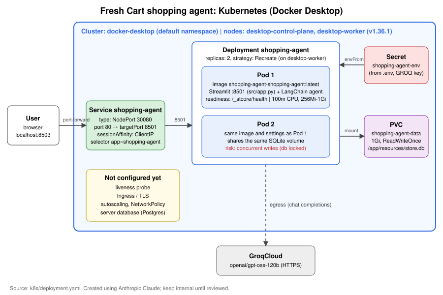
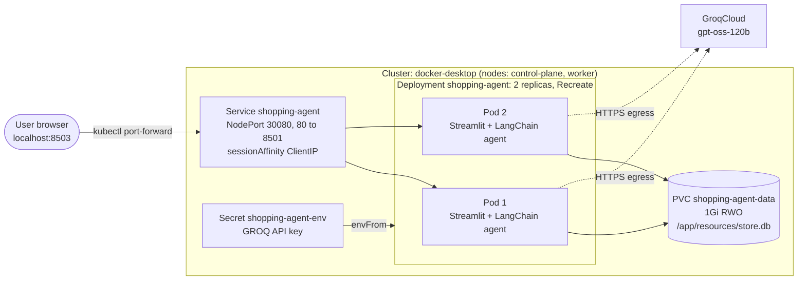

# Kubernetes architecture (as deployed)

Source of truth: `k8s/deployment.yaml` and `k8s/KUBERNETES_SETUP.md`.
Note the shared SQLite volume across 2 replicas (risk of "database is locked").

*Created using Anthropic Claude. Keep on internal versions until a human has reviewed and verified the content.*
